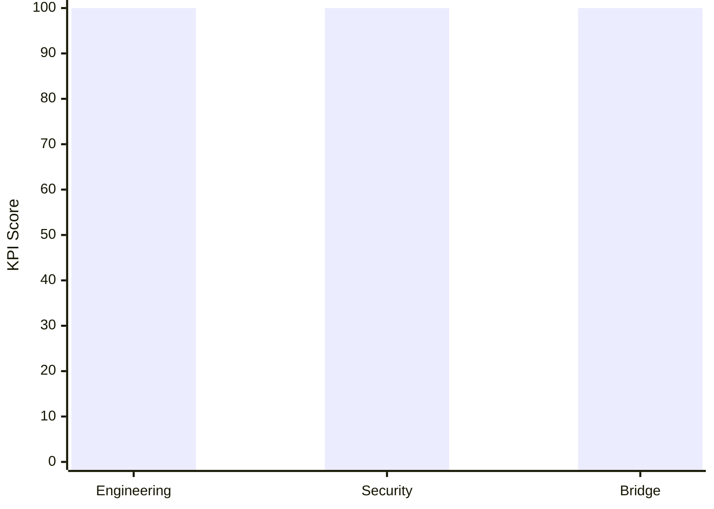

# How does Number One prevent AI sessions from losing context or repeating mistakes? {#numberone-explainer}

Number One attaches a hash-chained event stream to `.numberone/` so every edit, crash, thought, and ruling replays across **all 24+ AI harnesses** without losing history.

- `StreamStore` writes every workspace fact to `events.jsonl` with canonical SHA-256 hashes and linear-time secret redaction.
- `ReplayEngine` folds those atomic events into one verified `WorkspaceProjection` guarded by `snapshotDigest`.
- `AuthorityEngine` enforces `L1` stream truth and `L2` directives above `L4` session prompts.
- `PartyModeOrchestrator` runs three specialist officers and promotes new checks only when KPI delta exceeds zero.

@answer scope="Number One v1.0.0 · Node >= 22 · all MCP and CLI harnesses"
@meta locale=en style=editorial repo_url=https://github.com/onimurasame/numberone.git repo_revision=260ded9b532edcc9ccfe015cbf4af35bd2c5ecf7
@source stream_append title="StreamStore.append (SHA-256 + fsync)" path=src/core/stream-store.ts lines=388:407
@source authority_gate title="AuthorityEngine.PRECEDENCE (L1-L4)" path=src/core/authority-engine.ts lines=210:226
@source party_round2 title="resolvePeerChallenges (BMAD Round 2)" path=src/crew/party-mode.ts lines=85:104
@source evolution_gate title="KnowledgeEvolutionEngine.proposeUpdate" path=src/crew/evolution-engine.ts lines=98:116

## How do workspace signals become authoritative state? {#signal-pipeline}

@architecture id=sor-pipe title="Signal to System of Record"
| role frontend | Workspace Sensor |
| role security | Redaction & Gate |
| role database | Append-Only SoR |
| role backend | Replay & Crew |
| role cloud | Scrum Mirrors |
| sensors | Watchers & MCP | frontend | source:stream_append |
| redact | Secret Redactor | security |
| log | events.jsonl | database | source:stream_append |
| fold | ReplayEngine | backend |
| gate | Authority & Crew | security | source:authority_gate |
| mirrors | Directory / GitHub / Jira | cloud |
| sensors > redact | raw events |
| redact > log | SHA-256 | emphasis |
| log > fold | JSONL | emphasis |
| fold > gate | projection |
| log > mirrors | sync | dashed |

@steps id=sor-steps
| capture | Watchers & MCP | Captures edits, Git hooks, test crashes, transcripts, and MCP calls. | sor-pipe | sensors |
| scrub | Secret Redactor | Scrubs cloud keys, PATs, JWTs, PEM blocks, and SAS tokens in linear time. | sor-pipe | redact |
| chain | events.jsonl | Links `prevHash` to `hash` and flushes bytes with `fsyncSync`. | sor-pipe | log |
| rebuild | ReplayEngine | Rebuilds `WorkspaceProjection` and verifies `snapshotDigest`. | sor-pipe | fold |
| rule | Authority & Crew | Blocks `L4` plans that violate `L1` crashes, `L2` directives, or `L3` lessons. | sor-pipe | gate |

## How does L1–L4 arbitration stop repeated dead-ends? {#arbitration-panel}

@sequence id=arb-flow title="L4 Session vs L1-L3 Authority"
| actor agent | AI Harness | external |
| actor mcp | McpServer | frontend |
| actor auth | AuthorityEngine | security | source:authority_gate |
| actor store | StreamStore | database | source:stream_append |
| phase | Consultation & Proposal |
| agent | mcp | consult_number_one | emphasis |
| mcp | agent | lessons + dead-ends | return |
| agent | mcp | arbitrate_action | security |
| mcp | auth | check L1-L3 rules | security |
| auth | store | append arbitration.decided | emphasis |
| store | mcp | seq + SHA-256 hash | return |
| mcp | agent | APPROVE or BLOCK | return |

@code source=authority_gate language=ts

## Why does an external SoR outperform chat memory? {#comparison-panel}

| Capability | Chat Window Only | Number One SoR |
| --- | --- | --- |
| Context compaction | Drops failed tries {bad:Amnesia} | Preserves every dead-end {good:Durable} |
| Switching harnesses | Starts from zero {bad:Isolated} | Shares `.numberone` + MCP {good:Unified} |
| Security & release gates | Prompt advice only {caution:Soft} | Deterministic 0-100 KPIs {good:Enforced} |

@facts
| Event Types | `47` atomic schemas across 9 domains |
| MCP Surface | `12` tools and `4` live `numberone://` resources |
| Runtime Dependencies | `1` (`zod`) with `0` CVEs |

## What must an operator verify after attaching a workspace? {#verify-checklist}

- [ ] Run `n1 attach .` to initialize `.numberone/`, chained Git hooks, and universal shims.
- [ ] Run `n1 doctor` to confirm Node `>= 22`, hook permissions, and adapter readiness.
- [ ] Run `n1 verify --local-only` to validate every SHA-256 link and fallback blob.
- [ ] Run `n1 party --topic "Baseline readiness"` to record initial officer KPI scores.
