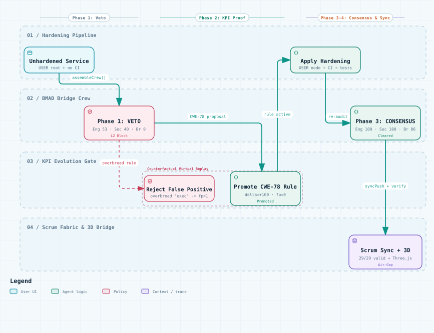

# Advanced Sample 2: BMAD Bridge Crew, KPI Self-Evolution & Distributed Scrum Command Bridge (Three.js + Archify)

> **Audience:** DevSecOps Leads, Platform Engineers & Staff/Principal Architects  
> **Live 3D Visualization (Three.js):** [Open 3D BMAD Command Bridge](https://onimurasame.github.io/numberone/examples/advanced-bmad-crew-evolution/)  
> **Interactive Archify Docs:** [Interactive Workflow v2 Diagram](https://onimurasame.github.io/numberone/archify/examples/advanced-bmad-crew-evolution-workflow.html) · [4-Style One-Page Explainer](https://onimurasame.github.io/numberone/archify/examples/advanced-bmad-crew-evolution-explainer.html)

## Four-Phase Governance Pipeline Exercised

This sample executes Number One's entire multi-officer DevSecOps and evolution stack with zero mocks:
1. **Phase 1 — Pre-Hardening Audit (`crew.veto` + `L2` Block)**: Audits an unhardened Payments API (`USER root`, no CI, no tests, no lockfile). Round 2 verifies peer challenges (`CONFIRMED`), emits `crew.veto`, and activates an automatic `L2` blocking directive (`Engineering 53.3`, `Security 40`, `Bridge 0`).
2. **Phase 2 — Empirically Verified KPI-Gated Evolution (`KnowledgeEvolutionEngine`)**:
   - Submits an overbroad candidate rule (`exec`) -> **REJECTED** (`falsePositivesAfter = 1` on clean `executeHealthCheck`).
   - Submits a precise `CWE-78` rule forbidding template interpolation in `execSync()` -> **PROMOTED** (`0% -> 100%` recall on real stream incident blob, `delta = +100`, `0` false positives).
3. **Phase 3 — Post-Remediation Audit (`crew.consensus`)**: Hardens the service (`USER node`, multi-stage build, `package-lock.json`, SHA-pinned CI & Release workflows, `vitest` suite, `SECURITY.md`, Dependabot, `scripts/rollback.sh`). Re-runs Party Mode -> reaches **`crew.consensus`** (`Engineering 100`, `Security 100`, `Bridge 86.4`) and auto-supersedes remediation gates.
4. **Phase 4 — Air-Gapped Distributed Scrum Sync (`DirectoryPersistenceAdapter` + `PersistenceFabric`)**: Mirrors `29/29` verified events to an external Kanban board and confirms `verifyIntegrity(true).valid === true`.

## Archify Multi-Phase Governance Workflow

<picture>
  <source media="(prefers-color-scheme: dark)" srcset="../../docs/assets/archify/examples/advanced-bmad-crew-evolution-workflow-dark.svg">
  <source media="(prefers-color-scheme: light)" srcset="../../docs/assets/archify/examples/advanced-bmad-crew-evolution-workflow-light.svg">
  
</picture>

## Run It Locally

```bash
npm run build
node examples/advanced-bmad-crew-evolution/run.mjs

# Optional: refresh Three.js data feed
node examples/advanced-bmad-crew-evolution/run.mjs --out docs/site/examples/advanced-bmad-crew-evolution/data.json
```

## Inside the Three.js 3D Command Bridge

- **Three Dynamic Officer KPI Towers** (*Engineering*, *Security*, *Bridge*) that smoothly interpolate in 3D height as you toggle between **Phase 1 (Veto)**, **Phase 2 (KPI Evolution)**, and **Phase 3 (Consensus + Sync)**.
- **Central Ruling Core & Peer Challenge Arc**: Flips from crimson `VETO` (with glowing Round 2 challenge arc) to emerald `CONSENSUS`.
- **Interactive Evolution Satellites & Scrum Sync Node**: Click the crimson Rejected box, emerald Promoted octahedron, or blue Distributed Scrum cylinder to inspect live JSON verification metrics.

**Files:** [`run.mjs`](./run.mjs) · [3D Viewer (`docs/site/examples/advanced-bmad-crew-evolution/`)](../../docs/site/examples/advanced-bmad-crew-evolution/index.html) · [Archify Workflow Spec](../../docs/archify/specs/examples/advanced-bmad-crew-evolution.workflow.json) · [Archify Explainer Spec](../../docs/archify/specs/examples/advanced-bmad-crew-evolution.archify.md)
