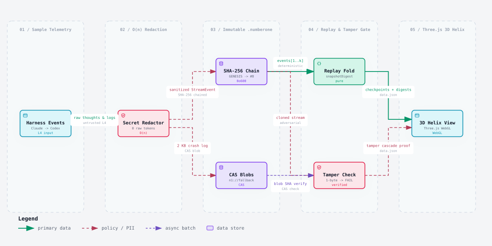

# Advanced Sample 1: SHA-256 Hash-Chain Helix, CAS Blobs & Replay Observatory (Three.js + Archify)

> **Audience:** Systems Engineers, Security Architects & Event-Sourcing Developers  
> **Live 3D Visualization (Three.js):** [Open 3D Hash-Chain Observatory](https://shadow-software-platform.github.io/numberone/examples/advanced-hash-chain-time-travel/)  
> **Interactive Archify Docs:** [Interactive Dataflow Diagram](https://shadow-software-platform.github.io/numberone/archify/examples/advanced-hash-chain-time-travel-dataflow.html) · [4-Style One-Page Explainer](https://shadow-software-platform.github.io/numberone/archify/examples/advanced-hash-chain-time-travel-explainer.html)

## Architectural Invariants Exercised

This sample runs real, zero-mock cryptographic storage and authority pipelines across simulated cross-harness handoffs (`claude-code` -> `codex-cli` -> `cursor`):
1. **Linear-Time `O(n)` Secret Redaction (`src/utils/redactor.ts`)**: Dynamically constructs synthetic GitHub PAT and AWS Access Key inputs at runtime and verifies zero raw credentials hit `.numberone/stream/`.
2. **Canonical JSON SHA-256 Hash Chaining (`StreamStore`)**: Appends 8 discrete `0o600` event files linked strictly from `GENESIS_HASH` with monotonic Crockford Base32 ULIDs.
3. **Content-Addressed Storage (`CAS`) Fallback Blobs**: Stores a multi-KB `CWE-1333` crash stack trace once under `.numberone/stream/blobs/<sha256>` addressed via `n1://fallback/<sha256>`.
4. **Affirmative-Clause `L1`–`L4` Arbitration (`AuthorityEngine`)**: Proves negated compliance (*"Do not call new Function(...); instead use strict linear-time string slicing"*) yields `APPROVE_WITH_CONDITIONS`, while an affirmative violation yields `BLOCK`.
5. **Deterministic Replay & Fail-Closed Tamper Proof (`ReplayEngine` + `StreamStore`)**: Computes canonical `snapshotDigest` checkpoints for `seq #1..#8`, then clones `.numberone/`, mutates 1 byte at `seq #4`, and proves `StreamStore.verifyIntegrity()` fails closed.

## Archify Cryptographic Lineage Dataflow

<picture>
  <source media="(prefers-color-scheme: dark)" srcset="../../docs/assets/archify/examples/advanced-hash-chain-time-travel-dataflow-dark.svg">
  <source media="(prefers-color-scheme: light)" srcset="../../docs/assets/archify/examples/advanced-hash-chain-time-travel-dataflow-light.svg">
  
</picture>

## Run It Locally

```bash
npm run build
node examples/advanced-hash-chain-time-travel/run.mjs

# Optional: refresh Three.js data feed
node examples/advanced-hash-chain-time-travel/run.mjs --out docs/site/examples/advanced-hash-chain-time-travel/data.json
```

## Inside the Three.js 3D Observatory

- **Helical SHA-256 Event Chain**: 8 hexagonal crystal prisms connected by animated verification conduits and traveling photon pulses, with an orbiting **CAS Blob satellite** tethered to `seq #4`.
- **Simulate 1-Byte Tamper Toggle**: Injects the real `seq #4` tamper proof live in 3D, cascading crimson hash fractures across every downstream event (`seq #4..#8`) and the central Replay Projection Core.
- **Deterministic `--until-seq` Scrubber**: Scrub across `1..8` to inspect exact historical `prevHash`, `hash`, `ULID`, and `snapshotDigest` checkpoints.

**Files:** [`run.mjs`](./run.mjs) · [3D Viewer (`docs/site/examples/advanced-hash-chain-time-travel/`)](../../docs/site/examples/advanced-hash-chain-time-travel/index.html) · [Archify Dataflow Spec](../../docs/archify/specs/examples/advanced-hash-chain-time-travel.dataflow.json) · [Archify Explainer Spec](../../docs/archify/specs/examples/advanced-hash-chain-time-travel.archify.md)
