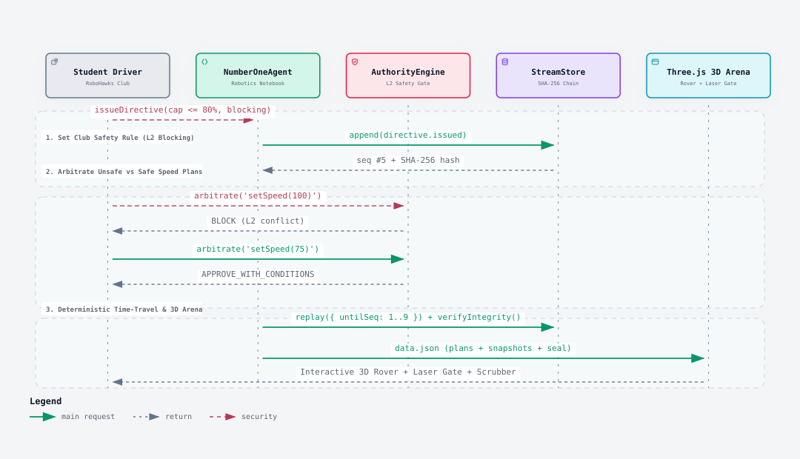

# Kids Sample 2: RoboHawks Safety Arena & Time Machine (Three.js + Archify)

> **Audience:** Kids, Coding Clubs & Robotics Teams (Grades 6–12)  
> **Live 3D Visualization (Three.js):** [Open RoboHawks 3D Safety Arena](https://shadow-software-platform.github.io/numberone/examples/kids-robotics-arena/)  
> **Interactive Archify Docs:** [Interactive Sequence Diagram](https://shadow-software-platform.github.io/numberone/archify/examples/kids-robotics-arena-sequence.html) · [4-Style One-Page Explainer](https://shadow-software-platform.github.io/numberone/archify/examples/kids-robotics-arena-explainer.html)

## What This Sample Teaches

Building a line-following robot for FIRST Robotics, VEX, or school coding club? This sample shows how `NumberOneAgent` protects your team's robot and builds a judge-ready Engineering Notebook:
1. **Track Team Build Tasks** (`openIssue` / `resolveIssue`) — calibrating the light sensor and attaching foam bumper rails around the classroom test table.
2. **Enforce a Blocking `L2` Safety Rule** (`issueDirective`) — caps indoor motor speed at `<= 80%` and forbids `setSpeed(100)` after an earlier table-edge skid (`recordFailedAttempt`).
3. **Test Driver Plans Before Running (`arbitrate`)**:
   - **Plan A (`setSpeed(100)`)** -> **`BLOCK`!** Drops the crimson 3D laser barrier and halts the rover safely!
   - **Plan B (`setSpeed(75)`)** -> **`APPROVE_WITH_CONDITIONS`!** Opens the emerald gate so the rover cruises smoothly.
   - **Plan C (`"Do not use setSpeed(100); instead run at setSpeed(68)"`)** -> **`APPROVE_WITH_CONDITIONS`!** Demonstrates Number One's smart negation-aware rule checking with zero false alarms.
4. **Time-Travel & Seal Verification** (`replay({ untilSeq })` + `verifyIntegrity(false)`).

## Archify Arbitration & Time-Travel Sequence

<picture>
  <source media="(prefers-color-scheme: dark)" srcset="../../docs/assets/archify/examples/kids-robotics-arena-sequence-dark.svg">
  <source media="(prefers-color-scheme: light)" srcset="../../docs/assets/archify/examples/kids-robotics-arena-sequence-light.svg">
  
</picture>

## Run It Yourself

```bash
npm run build
node examples/kids-robotics-arena/run.mjs
```

To regenerate the live Three.js 3D scene feed:

```bash
node examples/kids-robotics-arena/run.mjs --out docs/site/examples/kids-robotics-arena/data.json
```

## Inside the Three.js 3D Robotics Arena

- **3D Wheeled Rover Bot** with spinning wheels, glowing cyan light-sensor beam, and pulsing status mast driving around a black-tape oval track on a classroom table.
- **Interactive `L2` Laser Gate**: Toggle Plan A (`100%`) vs. Plan B (`75%`) vs. Plan C (`68%`) to watch the crimson laser beams drop and stop the rover — or lift open!
- **Time-Travel Scrubber (`seq #1..#9`)**: Rewind history to watch the foam guardrails and `L2` safety gate appear on the exact sequence they were logged!

**Files:** [`run.mjs`](./run.mjs) · [3D Viewer (`docs/site/examples/kids-robotics-arena/`)](../../docs/site/examples/kids-robotics-arena/index.html) · [Archify Sequence Spec](../../docs/archify/specs/examples/kids-robotics-arena.sequence.json) · [Archify Explainer Spec](../../docs/archify/specs/examples/kids-robotics-arena.archify.md)
