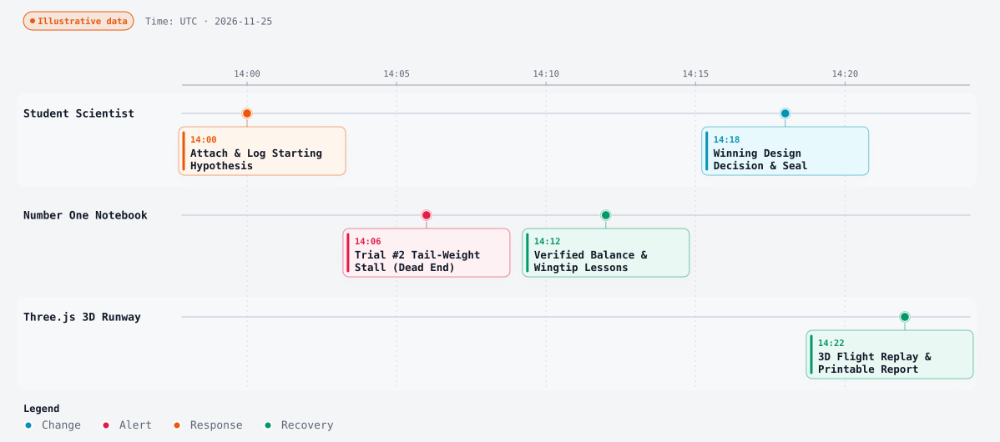

# Kids Sample 1: Paper Airplane Science Fair Flight Lab (Three.js + Archify)

> **Audience:** Kids, Students & Teachers (Grades 5–12)  
> **Live 3D Visualization (Three.js):** [Open Paper Airplane 3D Flight Lab](https://onimurasame.github.io/numberone/examples/kids-science-fair-glider/)  
> **Interactive Archify Docs:** [Interactive Timeline](https://onimurasame.github.io/numberone/archify/examples/kids-science-fair-glider-timeline.html) · [4-Style One-Page Explainer](https://onimurasame.github.io/numberone/archify/examples/kids-science-fair-glider-explainer.html)

## What This Sample Teaches

Testing which paper airplane design flies farthest for a Science Fair project? This sample shows how `NumberOneAgent` acts like an **un-erasable digital lab notebook** that remembers:
1. Your starting **hypothesis** (`recordThinking`).
2. **Failed flight trials / Dead Ends** (`recordFailedAttempt`) — Trial #2 taped two pennies to the tail, making the plane pitch up, stall, and drop at `1.4 m`!
3. **Verified Discoveries / Lessons Learned** (`captureLesson`) — clipping 1 paperclip to the nose (`9.4 m`) and folding `1 cm` upturned wingtips (`10.6 m`).
4. **Final Design Choice** (`recordDecision`) explaining *why* you chose the winning fold and which folds were rejected.
5. **Time-Travel Replay & Printable Report** (`replay({ untilSeq })` + `buildDocumentary()` -> 9-chapter Science Fair report!).

## Archify Experiment Timeline

<picture>
  <source media="(prefers-color-scheme: dark)" srcset="../../docs/assets/archify/examples/kids-science-fair-glider-timeline-dark.svg">
  <source media="(prefers-color-scheme: light)" srcset="../../docs/assets/archify/examples/kids-science-fair-glider-timeline-light.svg">
  
</picture>

## Run It Yourself

```bash
npm run build
node examples/kids-science-fair-glider/run.mjs
```

To regenerate the live Three.js 3D scene feed (`docs/site/examples/kids-science-fair-glider/data.json`):

```bash
node examples/kids-science-fair-glider/run.mjs --out docs/site/examples/kids-science-fair-glider/data.json
```

## Inside the Three.js 3D Flight Lab

- **4 animated 3D paper airplanes** flying along their exact parabolic trajectories (`5.8 m`, stalled `1.4 m`, nose-weighted `9.4 m`, and winged winner `10.6 m` with visible paperclip nose ring and upturned wingtips!).
- **Click any glider, arc, or landing beacon** to inspect its real SHA-256 hash and `StreamEvent` metadata.
- **Drag the Time-Travel Scrubber** (`seq #1` to `seq #9`) to watch your experiment unfold chronologically!

**Files:** [`run.mjs`](./run.mjs) · [3D Viewer (`docs/site/examples/kids-science-fair-glider/`)](../../docs/site/examples/kids-science-fair-glider/index.html) · [Archify Timeline Spec](../../docs/archify/specs/examples/kids-science-fair-glider.timeline.json) · [Archify Explainer Spec](../../docs/archify/specs/examples/kids-science-fair-glider.archify.md)
